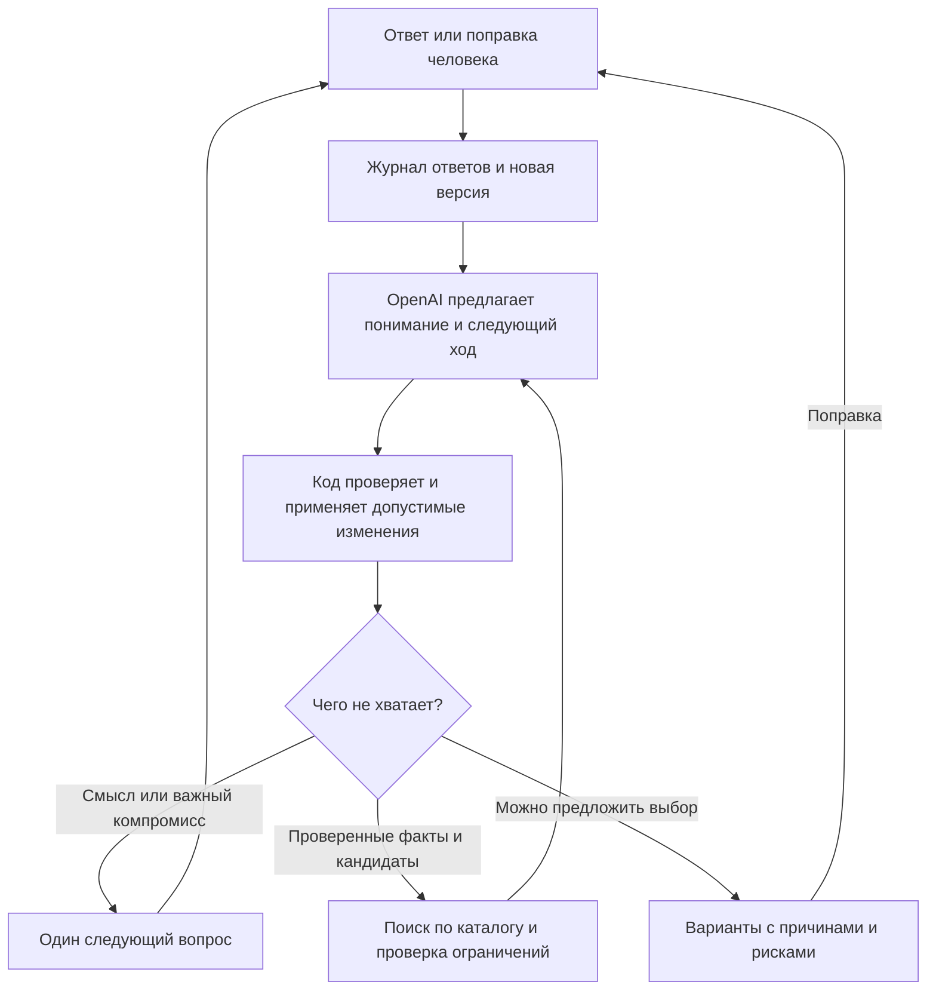

# Как перестроить подбор TASTIQ

1. **Как строить последовательный диалог, который выясняет сегодняшнее желание и позволяет человеку исправить наши предположения, не навязывая ответы?**
2. **Какие варианты распределения работы между OpenAI, кодом и каталогом доступны TASTIQ, чем они отличаются и какой я предлагаю выбрать?**
3. **Каким первым опытом проверить выбранное направление, что сохранить из проекта и по каким наблюдениям продолжать или отказаться?**

31.10.2026. Предложение для выбора владельцем; направление ещё не согласовано. Продуктовый код и работающий сервер не менялись, новых запросов к платному API приложения нет. Анализ опирается на текущий код, отзыв владельца, сохранённый разбор старого разговора и первичные исследования. Источники и пределы доказательств — в [Sources.md](E:/project/TASTIQ/research-vault/dialogue-architecture-2026-10/Sources.md).

## Что предлагаю и почему

**Строить разговор вокруг сегодняшнего запроса, который уточняется и исправляется на каждом шаге. OpenAI предлагает следующий осмысленный ход; приложение хранит основания, применяет поправки и проверяет ограничения.** Начать с небольшой версии такой архитектуры и сравнить её с более простым разговором под управлением модели. Если дополнительный контроль не помогает человеку, сохранить более простой вариант.

Ценность продукта: человеку не нужно заранее знать подходящее название или правильно формулировать жанры. Он может объяснить, чего хочет, узнать это по ходу разговора и получить несколько подходящих вариантов с понятными различиями. Хорошая рекомендация здесь — та, которую хочется выбрать **в этом контексте**, с честно обозначенными компромиссами. Сходство с любимой игрой — лишь одно свидетельство.

Сейчас имеются три связанные причины промаха:

- Начало зависит от популярности и базового контекста. При одинаковом контексте первая страница снова даёт те же восемь игр; отдельный жанровый инструмент не включён в маршрут. Поэтому мы собираем прошлые симпатии раньше сегодняшнего направления. [Начальные карточки](E:/project/TASTIQ/src/core/questions.js:13), [маршрут](E:/project/TASTIQ/src/core/dialogue.js:112).
- Основной разговор ведёт код: до двух объяснений симпатий, одно объяснение антипатии, затем ограничения и до трёх уточнений. Полезность уточнения привязана к изменению лидера. Это проверяет различие имеющихся кандидатов, но не доказывает, что правильно выбрана сама цель. [Диалог](E:/project/TASTIQ/src/core/dialogue.js:18), [уточнения](E:/project/TASTIQ/src/core/ask.js:210).
- Сегодняшние положительные пожелания ограничены относительно прошлого вкуса. «Только попробовал» уже исключает игру как потреблённую, вместе с серией. Более удачная формулировка вопроса сама эти решения не исправит. [Приоритеты](E:/project/TASTIQ/src/core/score.js:104), [знакомство](E:/project/TASTIQ/src/core/profile.js:67), [исключения](E:/project/TASTIQ/src/core/sieves.js:35).

Следовательно, перемешивание карточек, обязательный экран жанров или увеличение лимита вопросов по отдельности проблему не закрывают. В исследовании COLING 2025 дополнительные раунды даже ухудшали рекомендации при некоторых способах опроса; другие стратегии смягчали эффект. Это результат на их данных и старых моделях, а не прогноз для TASTIQ. Практический вывод для нас: измерять полезность разговора, а не его длину. [A Flash in the Pan](https://aclanthology.org/2025.coling-main.561/).

## Три архитектурных варианта

Варианты отличаются **тем, кто выбирает следующий ход и допускает завершение разговора**. Каталог, проверка доступности, журнал исходных ответов, исправляемое понимание и ограничения расходов нужны каждому. Чат или карточки — отдельный выбор интерфейса; везде возможен один понятный вопрос на экране.

| Вариант и рецепт | Что хорошо | Что плохо | Когда выбирать |
|---|---|---|---|
| **А. Код ведёт адаптивную анкету.** Реализовать ветки «направление → желаемый опыт → нужный пример → компромисс», пропуск уже известного и остановку. Модель разбирает свободный ответ человека и помогает с результатом. | Закрытые ответы обрабатываются сразу; легко воспроизвести путь и проверить каждую ветку. | Разработчик должен заранее предусмотреть смыслы и исключения. «Как X, но без Y» и смена желания быстро разрастаются в дерево; свободный текст рискует снова упереться в словарь. | Для ограниченной задачи с небольшим числом устойчивых развилок. Исправить нынешний маршрут можно, но широта обещания TASTIQ делает это дорогим в поддержке. |
| **Б. Модель ведёт разговор.** Дать OpenAI историю, редактируемую сводку и инструменты каталога. Она выбирает вопросы и момент выдачи; код проверяет формат, фактические ограничения и допустимые названия. | Быстрее получить живой прототип, естественно работать с необычными ответами и поправками. Сильный контрольный вариант для нашего сравнения. | Память о значении ответа и решение «достаточно понял» остаются модельными. Возможны повторы, уверенные проекции и забытая поправка; длинная история увеличивает контекст. | Если качественный сценарий с хорошими инструкциями и фактическими проверками уже удовлетворяет людей; сложность следующего варианта тогда может быть лишней. |
| **В. Модель предлагает, код хранит и проверяет состояние.** Небольшой журнал свидетельств, активное понимание запроса и версии. Модель предлагает изменения и действие; код проверяет допустимость изменения, повтор, отмену прежних выводов и условия перехода к результату. | Можно объяснить, откуда взялось предпочтение, отменить его последствия и проверить поведение после исправления. Гибкость вопросов сохраняется. | Больше разработки и возможного ожидания. Проверка цитаты не доказывает правильность её понимания. Избыточный контракт может снова навязать человеку наш язык. | Если поправки и смешанные желания — существенная часть продукта, а контроль действительно уменьшает потери смысла. **Мой предлагаемый основной вариант, пока как проверяемая гипотеза.** |

Сопоставление финалистов Б и В на одинаковых случаях:

| Критерий / ситуация | Б: разговор модели | В: проверяемое состояние |
|---|---|---|
| «Люблю BG3 за историю, спутники не принципиальны» | Инструкция и история должны удержать различие; можно показать и поправить сводку. | Прямая причина отделена от предположения о спутниках; поправка отменяет зависимые объяснения. Смысл извлечения всё равно может быть ошибочным. |
| «Передумал: сегодня хочу другое» | Модель пересматривает запрос по новой реплике. | Новая цель заменяет прежнюю сессию; код удаляет её зависимые ограничения и не принимает устаревший ответ API. |
| «Не знаю» / необычное желание | Проще свободно сменить способ разговора. | Не уступает только при наличии открытого текста и неизвестных значений; узкая схема сделает его хуже Б. |
| Исправление после результата | Модель перечитывает историю и перестраивает выдачу. | Видно, какая запись отменена и какие вопросы/кандидаты нужно пересчитать. |
| Задержка и сложность | Меньше обязательных механизмов; контекст может расти. | Версии, проверки и зависимости требуют поддержки; отдельный разбор и планирование удваивают последовательные модельные шаги. |
| Фактическая пригодность игры | В обоих случаях зависит от одинаковых данных и проверок каталога; способ ведения беседы её не гарантирует. | То же. |

Это архитектурные свойства и риски, а не результаты сравнительного теста. Для R ответов, требующих семантической работы, у Б ориентир R вызовов продолжения плюс финал. У В простая двухэтапная реализация потребует до 2R плюс финал; объединение разбора и следующего вопроса приближает её к R плюс финал, но отвергнутое изменение должно отменять и зависимый вопрос. Закрытые ответы могут обрабатываться локально. Реальные токены, задержку и дополнительные поисковые вызовы предстоит измерить; текущие доллары и секунды сюда не переносим.

## Как должен ощущаться разговор

Предлагаю основным способом **уточнение смысла ответа**, а пробные предложения использовать, когда человеку трудно описать желание. Это совместимо с Б и В. Полная анкета вкуса при каждом входе не нужна.

**1. Сначала дать выбрать направление.** «Во что тянет сегодня?» — видимые жанры/форматы, несколько вариантов и поле своих слов. Рядом входы «Похожее на…» и «Пока не знаю». Если человек уже написал «короткий линейный экшен на вечер», повторно экзаменовать его по жанрам незачем. Платформу и компанию можно взять из сохранённых данных с возможностью изменить; неизвестное существенное ограничение выясняется до уверенного результата.

**2. Выяснить желаемое действие или впечатление.** «Открытый мир» означает область поиска. Следующий вопрос должен различить, что в нём нужно: неожиданные истории, исследование, развитие героя, свобода экспериментов или свой вариант. Можно сочетать ответы. Если человек не знает, предложить понятные описания игровых занятий или предварительные направления, а не очередные названия незнакомых игр.

**3. Привлекать прошлый опыт по делу.** «Есть игра, из которой хочется что-то оставить?» Поиск своего названия всегда доступен; отсутствие знакомых примеров не блокирует продолжение. Если нужны карточки, они подбираются под текущий разговор, и человек может сказать, что не знаком ни с одной. Причину симпатии спрашиваем ради конкретной неоднозначности, не ради заполнения профиля.

**4. Уточнять существенный компромисс.** Для «прокачка без гринда» иногда нужно различить приятное постепенное развитие и повтор одинаковых действий ради ресурсов. Для «сюжет и свобода» — допустим ли медленный старт. Не задавать все вопросы подряд: если ответ уже понятен или не меняет существенную часть выбора, вопрос не нужен. Нельзя выдавать нехватку сведений в каталоге за неопределённость вкуса пользователя.

**5. Показывать короткое исправляемое понимание.** Например: «Ищем на PC сюжетную игру с живым миром; хочется самому действовать одним героем и развивать его без однообразного фарма. Реализм допустим, но сам по себе не преимущество». Это иллюстрация по старому разбору, не утверждение о сегодняшних желаниях владельца. После исправления меняются поиск и объяснения; не нужно начинать заново. Подтверждать каждую строчку отдельным экраном тоже не нужно.

**6. Выдавать ведущий вариант и несколько содержательных альтернатив.** Обычно один основной и две–четыре альтернативы: где сильнее история, где больше свободы, где легче начать — если именно эти различия важны в текущем запросе. На карточке: связь с конкретными словами человека, существенный риск, что пока не проверено. Не заполнять число карточек заведомо слабым выбором. «Не то» позволяет поправить направление, конкретное свойство или знакомство; показанная игра не становится автоматически нелюбимой.

«Оба», «неважно», «не знаю» и «ни один» имеют разные последствия. Первое сохраняет сочетание, второе убирает приоритет, третье оставляет неизвестность, четвёрто пересматривает постановку вопроса. Не обязательно показывать все четыре кнопки на каждом экране; нужные выходы должны быть доступны и не сливаться в одинаковое действие.

**Остановка:** понятен хотя бы рабочий запрос, существенные ограничения установлены либо явно обозначены как непроверенные, доступны правдоподобные варианты, а оставшийся вопрос не меняет важного выбора. Фиксированный лимит служит защитой от утомления, но не доказательством понимания. Человек может попросить предварительный результат раньше. Если условия конфликтуют или каталог не даёт ответа, показываем это и предлагаем пересмотреть конкретное условие; молча ослаблять его нельзя.

## Что хранить и чему доверять

У системы три отдельных представления: **исходные ответы → текущее понимание с основаниями → кандидаты и следующий ход**. Достаточно небольшого журнала и снимка состояния; отдельная графовая база для первого опыта не требуется.

| Смысл ответа | Следствие |
|---|---|
| «BG3 понравилась история» | Факт об опыте с BG3; любовь к пошаговому бою и спутникам из него не следует. |
| «Сегодня хочу линейную игру», хотя раньше любил открытый мир | Сегодняшняя цель ведёт поиск; прошлый вкус помогает внутри неё и не возвращает прежнюю цель скрытым весом. Не превращать каждое мягкое желание в обязательный фильтр. |
| «Реализм не нужен» | Не считать его преимуществом; это не запрет. |
| «Почему Metro не зашла — не помню» | Причина неизвестна; модель не дописывает её сама. |
| «Можно средневековье, если интересны история и мир» | Сохранить условие целиком; не разрезать на безусловные теги. |
| «Cyberpunk только начал, готов вернуться» | Знакомство, оценка и интерес — разные поля. Игра допускается при разрешённом продолжении, несмотря на прошлый запуск. |
| «Не сегодня» / «уже показывал» | Временный отказ / история показа; не постоянная антипатия и не запрет всей серии. |
| «Спутники не главное, ты это придумал» | Удалить неподтверждённый приоритет и его последствия; не создать новый запрет спутников. |

У записи различаются источник, время действия, степень обязательности, известность и условие. Цитата связывает интерпретацию с ответом, но не делает её истиной. Прямые однозначные кнопки код применяет сам; в свободном тексте важную неоднозначность нужно уточнить. Отдельные гипотезы могут породить вопрос, но не утверждение «ты любишь X».

Это существенный предел технологии: Structured Outputs обеспечивает форму ответа модели, а ошибки внутри допустимой структуры всё равно возможны. Поэтому схема не заменяет исправляемое понимание и человеческую проверку. [Документация OpenAI](https://developers.openai.com/api/docs/guides/structured-outputs).

Каждое действие относится к версии запроса. Исправление отменяет зависимые выводы; старый ответ API не перезаписывает новую цель. При ошибке API сохраняются ответ и принятая версия, доступны повтор или локальное продолжение с понятным ограничением. Циклы и автоматические платные повторы ограничены; для работы не нужен коллектив моделей на каждом вопросе.

## Как связать понимание с хорошими играми

Удачный разговор может закончиться плохим результатом, если нужной игры нет в каталоге, её ошибочно исключили или не передали финальному выбору. В старой диагностике из 12 ожидаемых игр все прошли сита, но в shortlist попали восемь. Это локальный диагностический набор, не оценка удовлетворённости пользователей. Сейчас модель обычно получает 40/60 кандидатов и может предложить до двух своих названий; их проверяют по всему допустимому каталогу. Такая проверка **не означает, что модель искала по всему каталогу**. [Диагностика](E:/project/TASTIQ/docs/JOURNEY_QUALITY_2026-10-31.md:28), [код поиска](E:/project/TASTIQ/src/ai/pick.js:22).

Первый опыт диалога должен использовать одинаковый поиск у обоих финалистов. После того как человек подтвердил смысл запроса, отдельно сравнить два способа:

- Модель предлагает названия по полному смыслу запроса; код разрешает их по каталогу и проверяет условия. Простая исходная точка, но зависит от знаний модели и может пропускать неизвестные ей игры.
- Объединение нынешнего рейтинга, текстового поиска по описаниям и разрешённых предложений модели; затем одинаковый финальный выбор. Выше возможность найти дополнительные варианты, но сложнее контролировать шум и стоимость контекста.

Связка диалога, профиля, внешнего поиска и ранжирования описана, например, в RecLLM. Это подтверждает осуществимость разделения, но показательный прототип для YouTube не доказывает, что оно улучшит наши игровые рекомендации. [RecLLM](https://arxiv.org/html/2305.07961v2).

Для каждой потери фиксируем путь: **есть в каталоге → допущена → найдена → рассмотрена → показана**. Если объект отсутствует, исправляем покрытие; если неверно исключён — политику; если был среди кандидатов — финальный выбор. Отсутствие сведений, например о точной вместимости кооператива, остаётся неизвестностью, а не подтверждением пригодности. Векторная база, массовая переразметка и обучение модели имеют смысл только после обнаружения соответствующей причины потерь.

## Первый этап после выбора направления

**1. Зафиксировать смысловые проверки без API.** Использовать старый разбор как диагностический пример. В нём есть пять раундов и важные коррекции, но нет полного сырого чата и подтверждения, что итоговая игра была начата и понравилась. Отсутствующие ответы не выдумывать. Добавить независимые случаи: «сегодня другой жанр», неизвестная цель, «как X без Y», возвращение в начатую игру, «ни один вариант ответа», поправка после результата и существенный факт, которого нет в каталоге. Это разные механизмы отказа, а не набор заранее угаданных названий.

**2. Сделать один законченный игровой путь в отдельном прототипе.** Вход → адаптивные вопросы → исправляемое понимание → варианты → поправка. Сохранить каталог, проверенные факты, транспорт OpenAI, учёт расходов и существующую обратную связь. Переработать управление разговором, представление знакомства/цели и приоритет сегодняшнего желания. Игровой путь проверяем первым; жанровые и контекстные правила фильмов и остальных разделов нельзя механически копировать из него.

**3. Сравнить Б и минимальный В на одном основании.** Одинаковые модель, каталог, фактические проверки, доступные действия, интерфейс и способ поиска; различается дополнительная проверка состояния и переходов в В. Сначала пройти один реальный свободный запрос владельца: есть ли нужный ответ, понятно ли зачем спрашивают, узнаёт ли человек себя в сводке. Серьёзную потерю смысла исправить до массовых прогонов. Для дальнейшего сравнения нужны другие реальные запросы, заранее записанные до выдачи. Порядок вариантов чередовать; одинаковые карточки результата можно оценивать без названия архитектуры. Маленький пилот — решение о следующем шаге, не статистическое доказательство превосходства.

**4. Различать проверку механики и качества.** Автоматически проверять явные запреты, отмену выводов, неизвестные факты, версии и повторные вопросы. Человек оценивает, верно ли его поняли, какие варианты подходят сейчас и почему. Затем отдельно — что выбрал, начал ли и каковы впечатления. Несколько ожидаемых игр полезны как диагностика поиска, но не полный правильный ответ. Симуляторы помогают искать ошибки; исследования находят расхождения их поведения с человеческим, поэтому одобрение агентов не заменяет этот проход. [Yoon et al., NAACL 2024](https://aclanthology.org/2024.naacl-long.83/).

**5. Продолжать только по установленной причине.** В выбираем, если его контроль помогает удерживать поправки и получать подходящий выбор при приемлемом ожидании. Если Б делает это не хуже и проще, выбираем Б. Если смысл верен, а варианты плохие, следующий опыт посвящаем поиску/данным, удерживая запрос постоянным. Если человек всё ещё выбирает «наименее неподходящую» кнопку, возвращаемся к разговору. Нарушенный явный запрет или потерянная поправка требуют исправления до расширения. Числовой процент «попадания» до человеческих данных не назначаем.

Первый этап намеренно не объединяет разработку диалога с большим факторным тестом поиска. Предложенный аналитиком опыт на 32 финальных вызова оставлен в [исходной записке](E:/project/TASTIQ/research-vault/dialogue-architecture-2026-10/raw/retrieval-evaluation.md) как возможный дальнейший дизайн, а не ближайшая задача. Платные прогоны — только после выбора направления и в пределах оставшегося общего лимита $5 с проверкой журнала перед запуском. Эта работа API приложения не расходовала.

## Прямые ответы для решения

**1. Какой разговор?** Ранний свободный выбор направления/жанра, затем уточнение смысла и существенных компромиссов по ответам. Примеры прошлого — по необходимости. Поправка меняет дальнейший ход и результат. Длина определяется оставшимися полезными вопросами, с доступным ранним результатом.

**2. Какие варианты и какой предлагаю?** А — код выбирает ветку; Б — модель ведёт разговор при фактических проверках; В — модель предлагает ход, код также управляет состоянием и допустимыми переходами. Предлагаю минимальный В и честный контроль Б. Цена В оправдана только наблюдаемой пользой от удержания смысла и поправок.

**3. Какой следующий шаг?** После выбора — один законченный игровой прототип с одинаковым поиском для Б/В и реальный проход. Сохраняем данные, факты, бюджетный транспорт и обратную связь; меняем логику цели и диалога. Поиск улучшаем отдельно после проверки понимания. Решение о направлении остаётся за владельцем; внедрения пока нет.
